# What a modern-web-guidance skill did for our receipts app

We asked an agent to "look for opportunities to modernize" the app with the `modern-web-guidance` skill loaded. It came back with **zero findings**. Everything below came from the mode we ran next, and from what we found once we stopped reading and started clicking.

## The scan said there was nothing to do

The skill's `legacy-scan` mode checks 35 rules from 33 guides, about 20% of the corpus, and skips 77 documentation and test files. It reported no issues. A scan measures its own rules, not the app.

So we ran the other mode: three areas — forms; chat and charts; the shell, CSS and security headers — each reviewed against guides retrieved by topic, around 30. That found 2 high-severity issues, 9 medium and roughly 13 low.

Guides that shaped changes: `accessibility`, `forms`, `autofill-sign-in-form`, `autofill-sign-up-form`, `validate-input-after-interaction`, `ime-safe-enter-submit`, `scrollability-affordance-hints`, `responsive-table`, `motion`, `form-fields-automatically-fit-contents`, `security`, `navbar`, `optimize-image-priority`, `dark-mode-toggle`, `improve-text-layout-and-legibility`, `form-factor-adaptation`, `typography`, `progress`.

## What changed

PR #236: eight commits, one per area, merged to `staging`, promoted to `main` in #237. Two more commits came from review.

### Every field on the receipt edit form

Labels were never associated with their inputs, so the tree read differently from the screen.

```text
before
  Merchant name   → "Store name"        (the placeholder)
  Address         → "Street address"
  ABN             → "00 000 000 000"
  Subtotal        → spinbutton, no name
  "Added from"    → combobox "Timezone"
  "Kind"          → "Line kind"
  every item row  → button "Remove item"

after
  Merchant name   → "Name"
  Address         → "Address"
  ABN             → "ABN"
  Subtotal        → spinbutton "Subtotal"
  "Added from"    → combobox "Added from", with its description
  "Kind"          → "Kind"
  every item row  → button "Remove Batch Brew"
  empty name      → invalid="true", error as the description
```

`aria-invalid` reaches the input now, so the error is announced and the border turns red.

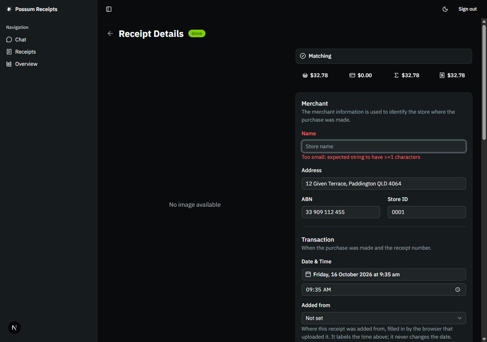

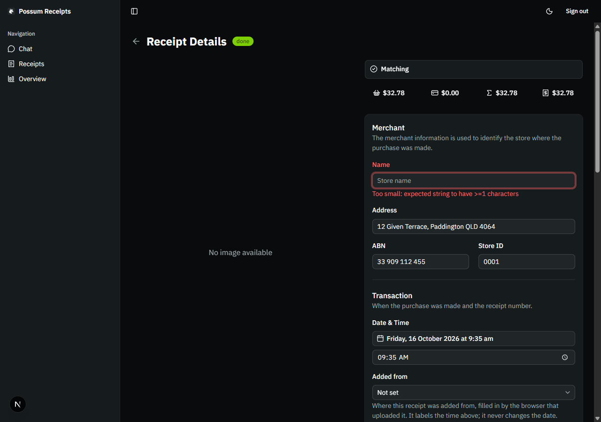

### The timezone picker

"Added from" was a `Select` with 419 options and no search. `forms` is blunt — 10+ dynamic options means a fuzzy search — so it is a Base UI `Combobox` now: "new york" gives `America/New_York`, "bris" gives `Australia/Brisbane`.

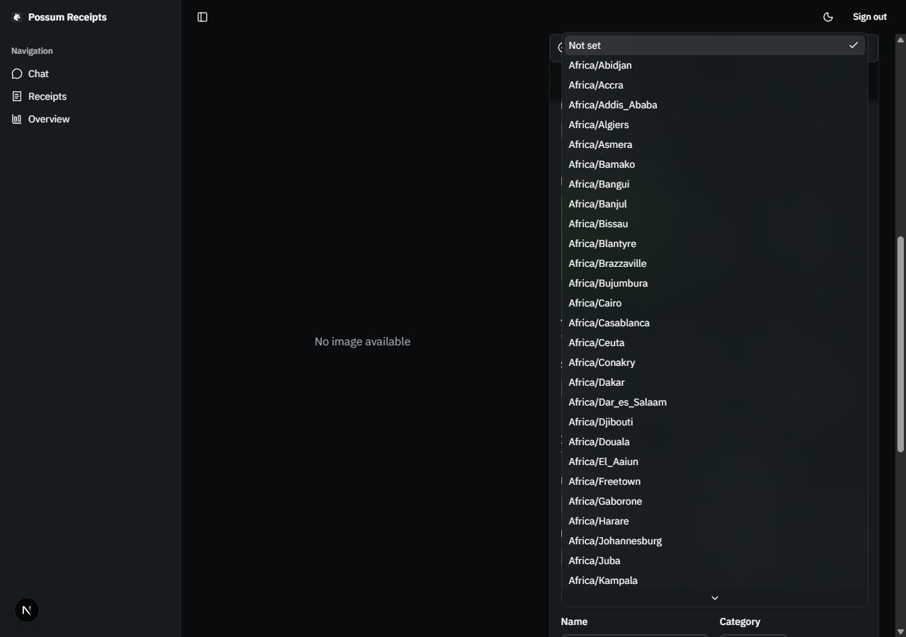

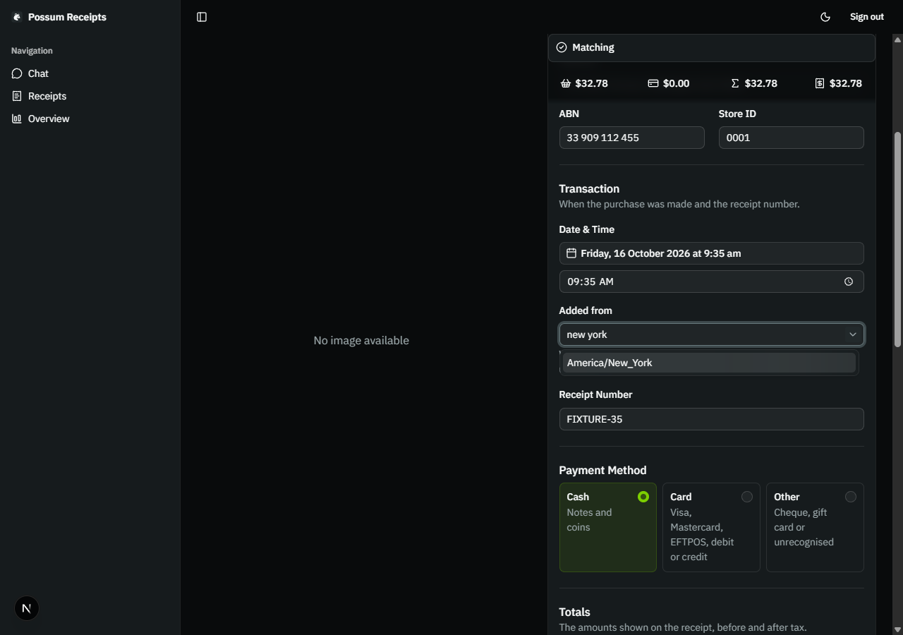

### Charts you can open from the keyboard

Every overview drill-down was wired to the chart's click handler: pointer only. Recharts' accessibility layer moves the tooltip with the arrow keys but never fires `onClick`; the merchant card's tab stops were the period select and the SVG. "Provide semantic data tables as accessible alternatives for charts", says the guidance, so each chart has a **Show data** button calling the same toggle the bars call, with `aria-pressed`. Show data → Tab → Enter opens the panel.

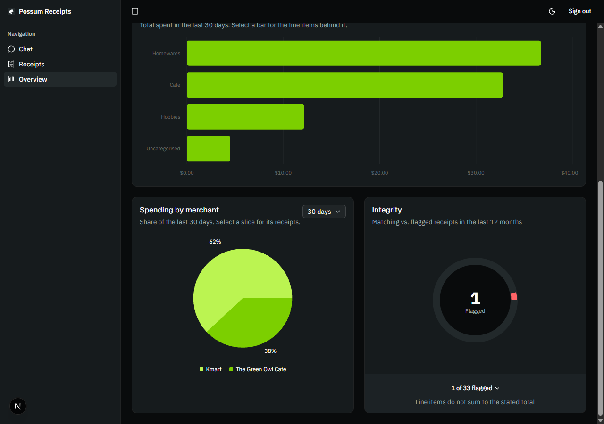

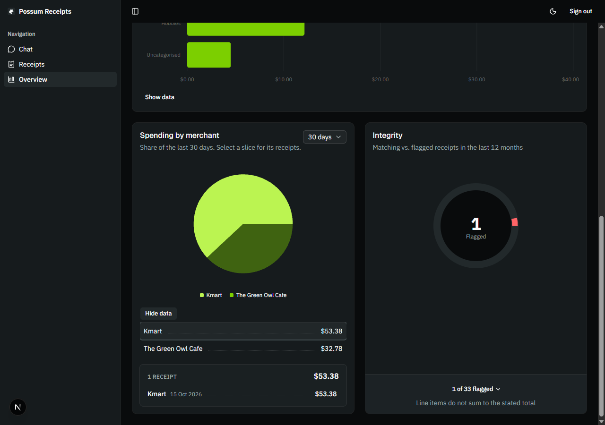

### The mobile scroll strip

Below `sm` the daily spending chart becomes a horizontal strip, since thirty days in a 295px card left each bar 5px wide. It hid its scrollbar and was not focusable, so nothing suggested it scrolls; it is a named, focusable region now, and the arrow keys pan it.

The rail was the better catch: its thumb was `--chart-1`, the lime highlight, at **1.30:1** on the white card, against a 3:1 rule for the hint. It is a per-theme `--chart-rail` token now (`--chart-4` in light), 4.96:1 on the card and 3.98:1 on the track, 4px thick instead of 3px. Both frames here are light mode, where the fix applies: dark mode already used the bright green on the dark card.

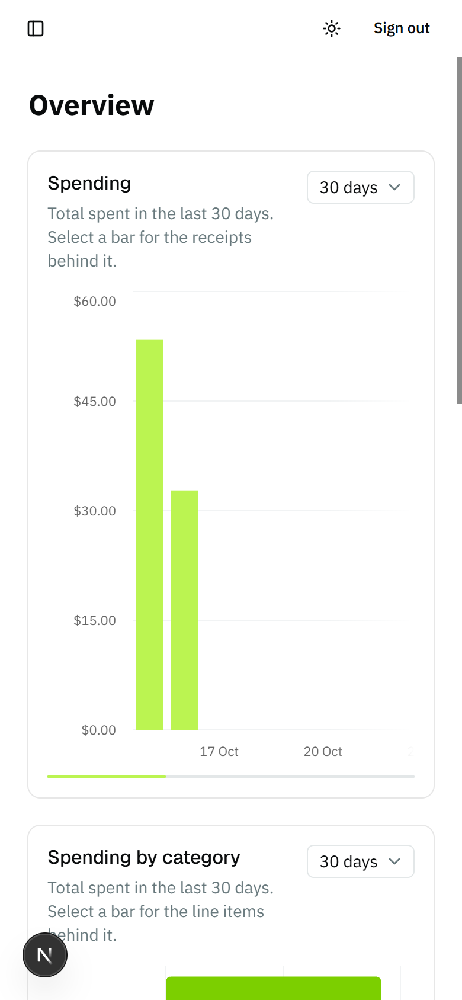

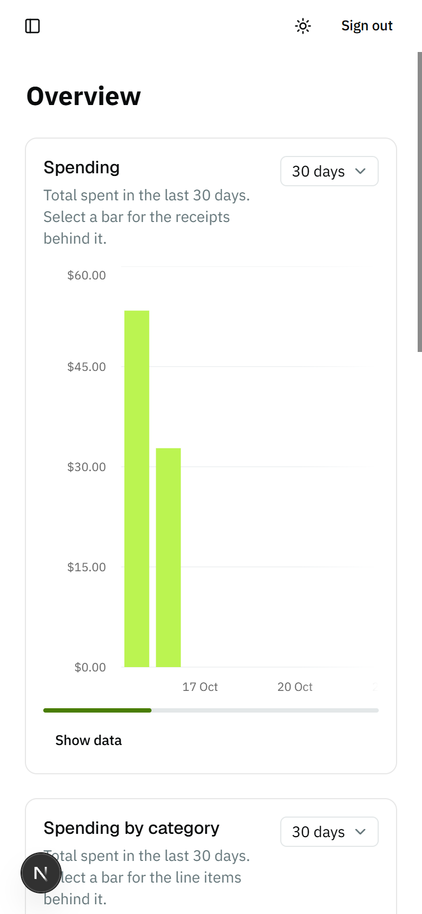

### The chat composer

The composer had no accessible name, only a placeholder, so it is `aria-label="Message"` now. It also grew without limit — a 30-line paste made it **616px** tall — so, per `form-fields-automatically-fit-contents`, it caps at 200px (`max-h-[10lh]`) and scrolls.

Enter-to-send checked only `isComposing`, which is not enough for Safari: it can fire the confirming Enter after `compositionend`, sending a half-composed Japanese, Chinese or Korean word. It checks `keyCode === 229` now. Per-step `aria-live` regions, and a "Thinking…" region that mounted with its text already in it, announce nothing; one `<output>` says exactly "Answer ready" once per turn, checked with a `MutationObserver`.

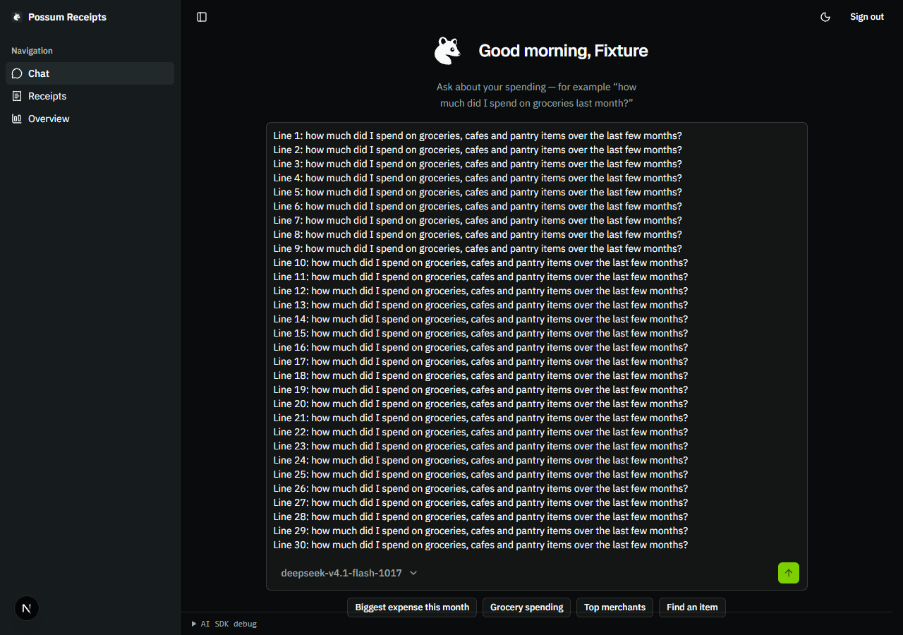

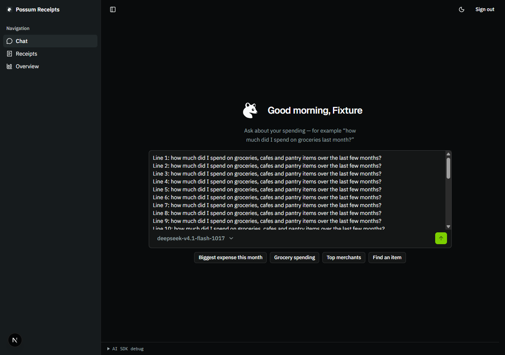

### Sign-up and the theme menu

The sign-up email used `autocomplete="email"`, so password managers treated it as a contact address; it is `username` now, pairing it with the new password, and identifiers turn off `spellcheck`. The rule "At least 8 characters." is visible up front and is the field's description; before, you learned it by failing. The theme menu's "System" now reads "System (currently dark)".

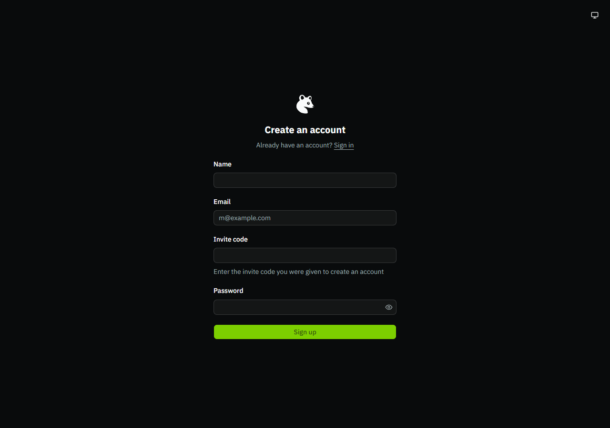

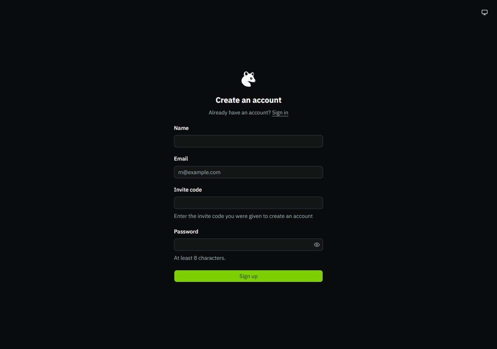

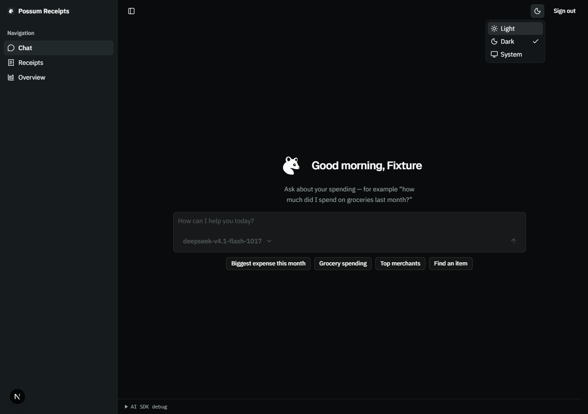

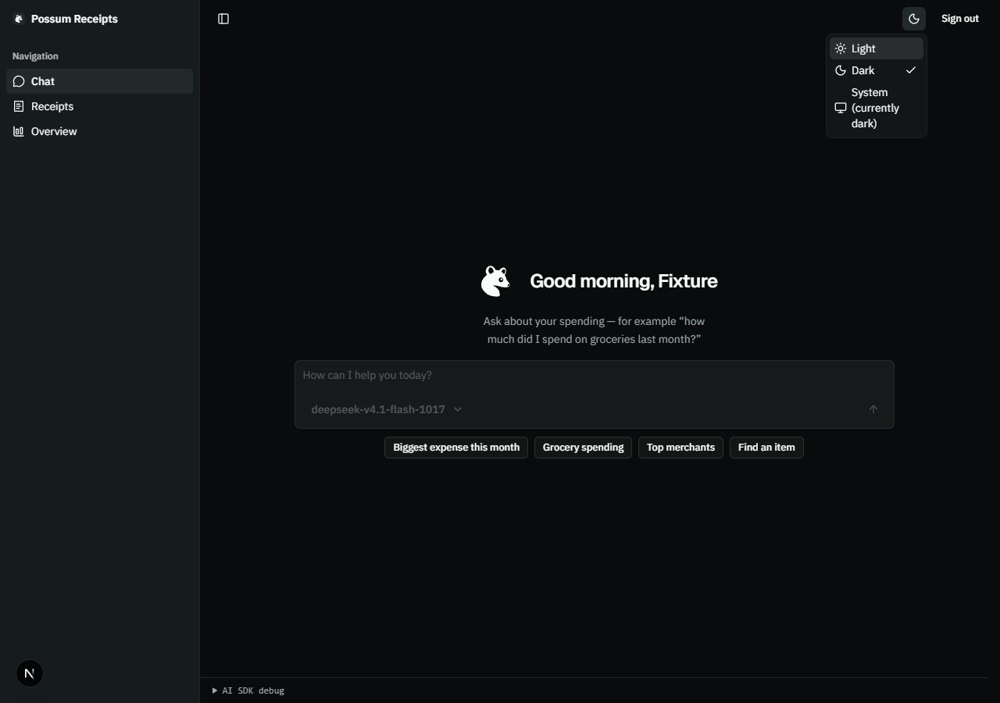

### Security headers

Production returned none. It now returns HSTS (two years, `includeSubDomains`, no `preload`), `nosniff`, `Referrer-Policy`, `Permissions-Policy`, `X-Frame-Options: DENY`, an enforced `frame-ancestors 'none'`, and a report-only CSP with a fresh nonce and `'strict-dynamic'`. Live production output, nonce elided:

```text
content-security-policy: frame-ancestors 'none'
content-security-policy-report-only: default-src 'self'; script-src 'self' 'nonce-…' 'strict-dynamic'; style-src 'self' 'unsafe-inline'; img-src 'self' data: blob: https://uploads.tribi.dev; connect-src 'self' https://uploads.tribi.dev wss://api.inngest.com; object-src 'none'; base-uri 'self'; frame-ancestors 'none'
permissions-policy: camera=(), microphone=(), geolocation=()
referrer-policy: strict-origin-when-cross-origin
strict-transport-security: max-age=63072000; includeSubDomains
x-content-type-options: nosniff
x-frame-options: DENY
```

### The upload card

The busy state used `disabled`, taking the button out of the tab order and dropping focus to `<body>`. It uses `aria-disabled` now and holds focus. Each stage shows as shimmering text above an indeterminate `<progress>` line. The second `ToastProvider` that announced every interim stage is gone: one toast region, outcome only.

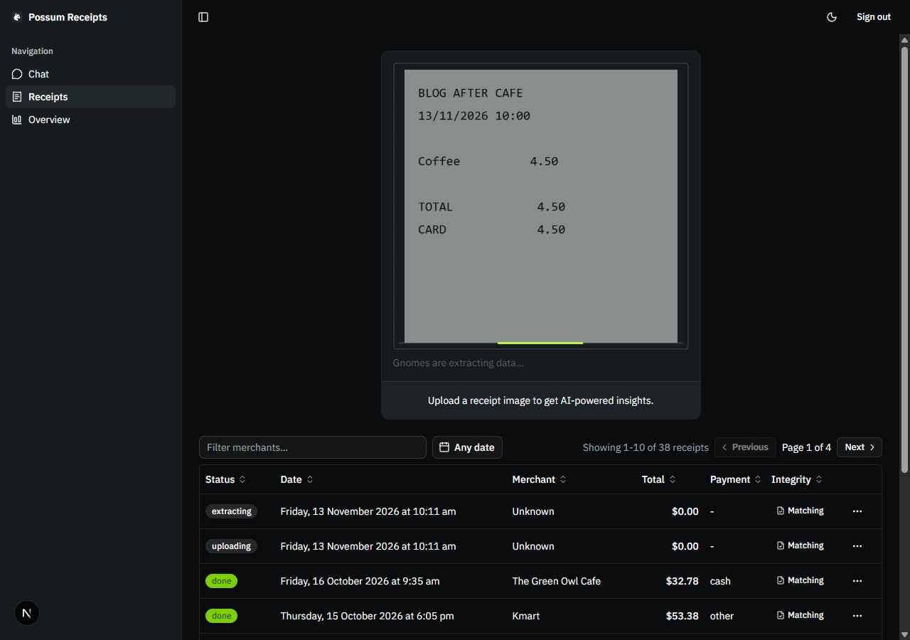

We could not capture an honest "before": the old code on another port was rejected by storage CORS, so its card shows the browser's "Failed to fetch". Still worth seeing — raw error text on screen, which the repo's error-handling ADR forbids. Error copy now passes `isUserMessage`.

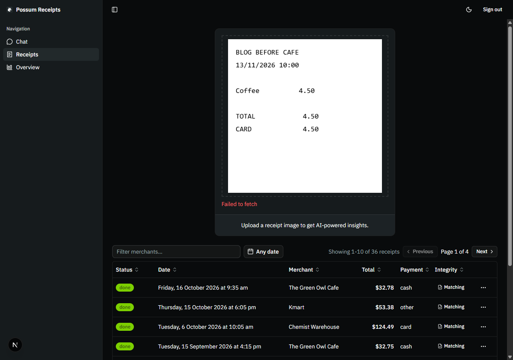

Smaller things in the same PR: `aria-current="page"` on the sidebar, `fetchpriority="high"` on the receipt image, `text-wrap: balance` on headings and `pretty` on paragraphs, and side safe-area insets.

## Where the skill changed our first instinct

The `progress` guide says never to disable the indeterminate animation: `animation: none` leaves a zero-width fill in Chromium, so reduced motion slows it from 1.5s to 10s instead. The same guide notes that a browser drops any rule it cannot parse, which is why `::-webkit-progress-value` and `::-moz-progress-bar` never share one.

Contrast changed the next decision: the app's primary green is the obvious fill and it is 1.54:1 on the white card, so the 3:1 rule pushed us to a per-theme rail token.

Security changed two. Report-only first: "use Report-Only headers to identify potential breakages before they happen". And a nonce with `'strict-dynamic'` rather than a host allowlist.

And the smallest: "do not apply `text-wrap: balance` globally".

## What it didn't catch

**CSP built at build time.** The first version assembled the policy in `next.config.ts`. The Docker build has no `STORAGE_PUBLIC_ENDPOINT`, so production would have shipped without the upload origin, silently. Flagged as an assumption, caught in review, moved to `proxy.ts` at runtime.

**The touch font floor.** A pre-existing bug the guides had nothing to say about. The 16px anti-zoom floor lived in `@layer base`; Tailwind's `md:text-sm` lives in the utilities layer, so at ≥768px the utility won. On a landscape phone (844×390) inputs computed 14px and iOS zoomed on focus. Only emulating that device surfaced it.

**The progress bar's width.** Our first line rendered 140px wide in a 416px drop zone. A `<progress>` keeps the UA default `inline-size: 10em`, so `left`/`right` insets do not stretch it. Seen in a screenshot.

**Focus lost on remount.** The card remounts when a receipt finishes, dropping focus to `<body>` again. Focus returns to the new drop zone now, but only if it was inside the card.

**Two regressions we introduced, plus a wrong claim in our own PR text** — all caught by the review bot. We added `aria-label="Upload a receipt image"` to the drop zone, overriding its visible instruction — a WCAG 2.5.3 label-in-name failure, since a voice-control user could no longer say the words on it. Removed. And one edit-form field gated `aria-describedby` on the error _object_ rather than its message, pointing at an element that never renders; one `hasError` predicate drives both now. The wrong claim was ours: `includeSubDomains` covers `receipts.tribi.dev` and its subdomains, not siblings like `uploads.tribi.dev`.

**A failed upload that looked busy.** After `/api/upload` or the storage PUT failed, the card returned to idle with the stage still set, shimmering over a progress bar that never stopped. That shipped; #238 fixed it and recorded ADR-0019, because we had shipped the headers with no ADR.

## Still open

The skill produced a list, not a finished app.

- Zod's default message, "Too small: expected string to have >=1 characters", shows to users on an empty merchant name.
- Every receipts-table row has a button called "Open row actions", which says nothing about which row.
- Found while writing this: the money spinbuttons expose float noise — `valuetext` "32.78", `value` "32.779998779296875", before and after. The columns are `numeric`, so it is introduced client-side. Not investigated.
- Skipped on purpose: a CSS-only scroll-driven edge fade. The JS one works, and the CSS version only reached Baseline in October 2026.

## What we would do again

The scan alone would have told us there was nothing to do, and we would have believed it. What worked was reading by topic and getting a quotable rule — 3:1 for the rail, no `animation: none`, report-only first.

What the guides cannot do is look at the app. Three bugs above — the landscape font floor, the 140px progress line, the focus lost on remount — only appeared in DevTools with device emulation, an accessibility snapshot, or a real upload through Inngest. The review bot caught two regressions we had just introduced, plus a wrong claim in our own PR description. Treat the skill as the reading list and the browser as the test.

## By the numbers

- **0** findings from the automated scan.
- **~30** guides read across three review areas.
- **8** commits in #236, **2** review fixes, **3** more in #238.
- **700 → 759** passing, 4 skipped, measured on `staging` just before #236 and after #238.
- **3** bugs found only in a browser.
- **2** regressions caught by the reviewer (plus one wrong claim in our PR text).
